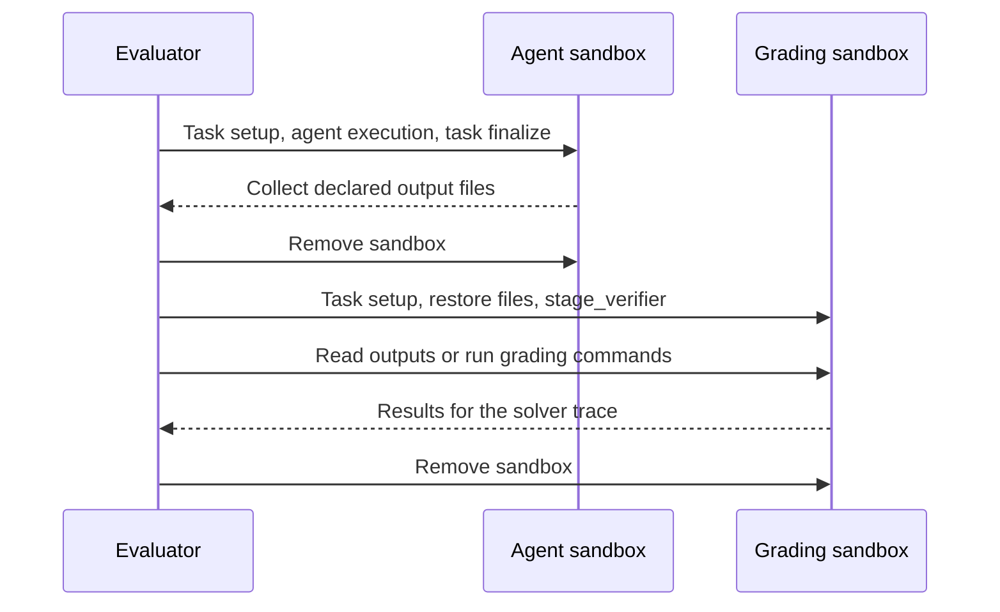

# Building Environments

An environment package defines the tasks an agent receives, the files and tools available during a rollout, and how the final work is scored. Most environments only need a `Taskset` and a `Task`, since the built-in `Env` classes and rollout scoring modes already cover single-agent evaluation, isolated grading, and multi-agent judges; you only need to write a custom `Env` when you want bespoke control flow between agents.

## Choose where the work runs

A verifiers evaluation spans up to four execution boundaries:

- **The evaluator** (the machine running `vf-eval` or an environment worker) loads datasets, runs Python task hooks (`setup`, `finalize`, `@vf.reward`), coordinates agents, and records traces.
- **The agent sandbox** (the agent's configured [runtime](runtimes.md#capability-matrix)) runs the harness, holds the task workspace, and executes any commands the agent invokes.
- **The grading sandbox** is a fresh container started after the agent finishes when you use isolated scoring (`ScoringConfig(mode="isolated")`), giving graders a clean filesystem containing only declared agent outputs and private test assets.
- **Task tools** run in their own configured runtime by default, inside the agent sandbox when configured with `colocated = true`, inside a named Compose service when configured with `service = "<name>"`, or on a Prime VM of their own, under its own egress policy, when their `runtime` is a Prime runtime beside a Prime workspace.

Because Python task hooks always execute on the evaluator, calling `Path.read_text()` reads from the evaluator's own filesystem, whereas `await runtime.read()` or `await runtime.run()` operates inside whichever sandbox was passed to the hook (the agent sandbox during `setup` and `finalize`, or the grading sandbox during isolated scoring). For answer-only benchmarks, scoring the final message in `@vf.reward` with the default `SingleAgentEnv` is all you need. When tasks modify files or execute untrusted code, you can either score directly inside the agent's sandbox or transfer the outputs into a separate grading sandbox.

## Create a package

To scaffold a new environment package inside a verifiers checkout, initialize a standalone library with `uv` and add an editable dependency on the repository:

```bash
uv init --lib --build-backend hatch --no-workspace --python '>=3.11' environments/file_sum_v1
uv add --project environments/file_sum_v1 --editable "$PWD"
```

This creates `environments/file_sum_v1/pyproject.toml` with its own dependency list. Define your task data, lifecycle hooks, and scoring in `environments/file_sum_v1/src/file_sum_v1/taskset.py`, and re-export the `Taskset` (along with an `Env` class if the package requires a custom one) from `src/file_sum_v1/__init__.py` so verifiers can discover them.

As covered in [tasksets](tasksets.md), dataset-level options belong on `TasksetConfig`, per-task behavior settings belong on `TaskConfig`, and immutable per-example fields belong on `TaskData`. Always load tasks by implementing `Taskset.load()` rather than overriding `Taskset.__init__`.

## Load an existing benchmark

When wrapping an existing benchmark, fetch the underlying dataset inside `Taskset.load()` on the evaluator (for example, by passing dataset name, split, and revision fields from `TasksetConfig` to Hugging Face's `load_dataset`). Filter out unsupported rows in `load()`, but leave subset sampling to the evaluation's `select` config so users can slice the benchmark from the CLI or TOML. Store reference answers and other ground-truth metadata on a `TaskData` subclass; extra `TaskData` fields stay on the evaluator for scoring and are never injected into the agent's prompt. Set `TaskData.id` to a stable upstream identifier (leaving `idx` for verifiers to assign from the loaded stream order) and pin dataset revisions and container images when you need reproducible runs.

Because dataset caches and package files live on the evaluator, they do not appear inside local containers or remote sandboxes automatically. Write small agent-visible inputs into the sandbox with `await runtime.write(...)` during `setup`, or bake large assets directly into the task image. Any private test scripts or reference files should be bundled inside your Python package, read via `importlib.resources` (rather than relative working-directory paths), and written into the sandbox only during `stage_verifier` so the agent cannot inspect them; see [packaged grader scripts](runtimes.md#packaged-grader-scripts) for managing dependencies across evaluator and sandbox environments. Similarly, if a task sets `TaskData.agent_user`, keep in mind that `setup` still runs as the runtime's default user, so any working directories or output paths created during `setup` must be made writable by `agent_user` before the harness starts (see [execution users](runtimes.md#execution-users)).

The [`prime-envs`](https://github.com/PrimeIntellect-ai/prime-envs) repository contains production implementations of these patterns (check each package's `pyproject.toml` for the verifiers version it targets):

| Pattern | Example | Guide |
| --- | --- | --- |
| Large context files and answer files | [GraphWalks](https://github.com/PrimeIntellect-ai/prime-envs/tree/main/environments/long_context/graphwalks) | [File answers](tasksets.md#file-answers-and-shared-scoring-inputs) |
| Read an answer once for several scores | [LongBench-Pro](https://github.com/PrimeIntellect-ai/prime-envs/tree/main/environments/long_context/longbenchpro) | [Shared scoring inputs](tasksets.md#file-answers-and-shared-scoring-inputs) |
| Packaged Python grader | [HumanEval](https://github.com/PrimeIntellect-ai/prime-envs/tree/main/environments/code/humaneval) | [Grader dependencies](runtimes.md#packaged-grader-scripts) |
| Tool state used by task scoring | [Wikispeedia](https://github.com/PrimeIntellect-ai/prime-envs/tree/main/environments/reasoning/wikispeedia) | [Stateful tools](tasksets.md#stateful-tools) |
| Harness defaults selected by task settings | [HLE-Diamond](https://github.com/PrimeIntellect-ai/prime-envs/tree/main/environments/knowledge/hle_diamond) | [Role defaults](env.md#role-defaults) |
| Scripted user messages in one rollout | [BFCL v3](https://github.com/PrimeIntellect-ai/prime-envs/tree/main/environments/tool_use/bfcl_v3), [SciCode](https://github.com/PrimeIntellect-ai/prime-envs/tree/main/environments/code/scicode) | [Multi-turn interactions](agent.md) |
| Private grading shared by several tasksets | [Lean common](https://github.com/PrimeIntellect-ai/prime-envs/tree/main/packages/lean_common) | [Private tests](#transfer-outputs-and-prepare-private-tests) |
| A tool calling an external evaluation service | [PTX remote](https://github.com/PrimeIntellect-ai/prime-envs/tree/main/environments/code/ptx_remote) | [Stateful tools](tasksets.md#stateful-tools) |

When a tool delegates execution to an external service (like `ptx_remote` above), that service manages its own compute, files, and networking outside the agent runtime. Store the service's response on rollout state so `@vf.reward` can score it, and copy any diagnostic output you want persisted into `trace.info`.

## Separate agent and grading sandboxes

When a task's grading logic shouldn't run inside the solver's sandbox (for example, because the agent could modify test files, environment state, or installed packages), configure isolated scoring with `scoring=vf.ScoringConfig(mode="isolated")` on `TaskData` (or pass `--env.agent.scoring.mode isolated` at evaluation time). The rollout runs the solver agent, copies only the declared output artifacts out of the solver container before tearing it down, and starts a fresh grading container to run your `@vf.reward` and `@vf.metric` methods against the solver's trace.



Here is a complete `src/file_sum_v1/taskset.py` that stages an input file for the solver and grades the output file in an isolated sandbox by default:

```python
import verifiers.v1 as vf


class FileSumTask(vf.Task[vf.TaskData]):
    NEEDS_CONTAINER = True

    async def setup(self, runtime: vf.Runtime) -> None:
        await runtime.write("/app/input.txt", b"1\n2\n3\n")
        await runtime.write("/app/output/answer.txt", b"")

    @vf.reward
    async def correct(self, runtime: vf.Runtime) -> float:
        answer = await runtime.read("/app/output/answer.txt", max_bytes=1024)
        return float(answer.strip() == b"6")

    async def validate(self, runtime: vf.Runtime) -> bool:
        await runtime.write("/app/output/answer.txt", b"6\n")
        return bool(await self.correct(runtime))


class FileSumTaskset(vf.Taskset[FileSumTask, vf.TasksetConfig]):
    def load(self) -> list[FileSumTask]:
        return [
            FileSumTask(
                vf.TaskData(
                    prompt=(
                        "Sum the integers in /app/input.txt. Write only the sum "
                        "to /app/output/answer.txt."
                    ),
                    image="python:3.11-slim",
                    workdir="/app",
                    scoring=vf.ScoringConfig(mode="isolated"),
                    artifacts=[vf.Artifact(source="/app/output")],
                ),
                self.config.task,
            )
        ]
```

Because `setup` runs in both the solver sandbox and the fresh grading sandbox, writing an empty `/app/output/answer.txt` during `setup` guarantees that an untouched task scores zero instead of failing with a missing-file error. When the grading sandbox starts, verifiers runs `setup` first and then restores `/app/output` from the solver, overwriting the placeholder with the agent's actual output before `correct` reads it. The `validate` method reuses the same reward function by writing the known gold answer and checking that `correct` returns `1.0`.

Export `FileSumTaskset` in `src/file_sum_v1/__init__.py`:

```python
from file_sum_v1.taskset import FileSumTaskset

__all__ = ["FileSumTaskset"]
```

Setting `scoring=vf.ScoringConfig(mode="isolated")` on `TaskData` makes isolated grading the default for this task, while still allowing users to override it at evaluation time with `--env.agent.scoring.mode shared|isolated` (see [verification placement](agent.md#verification-placement)). For Harbor benchmarks, see Harbor's [separate-verifier settings](harbor.md#separate-verifier-environments).

### Choose a different grading runtime or image

Save an evaluation config as `file-sum.toml`:

```toml
model = "z-ai/glm-5.2"

[env.taskset]
id = "file-sum-v1"

[env.agent.harness]
id = "bash"

[env.agent.runtime]
type = "docker"
cpu = 2
memory = 4

[env.agent.scoring]
mode = "isolated"

[env.agent.scoring.runtime]
type = "docker"
image = "python:3.11-slim"
cpu = 1
memory = 1
```

If you omit `[env.agent.scoring.runtime]`, the verifier provisions a fresh container using the agent's runtime policy and the task's scoring requirements. Providing `[env.agent.scoring.runtime]` lets you configure the grading sandbox independently: you can give it smaller CPU and memory limits, different network rules, a different container backend, or a dedicated `image` preloaded with test dependencies that you do not want in the solver image. You can also set `env.agent.scoring.env` to merge scoring-only environment variables over `TaskData.scoring.env` (using `${VAR}` or `${VAR:-default}` templates so raw secrets are resolved at scoring time rather than written into saved configs).

Both the solver and verifier must run on container-backed runtimes (`subprocess` does not support artifact collection or isolated grading). Because artifacts are restored without path translation, relative artifact paths require the solver and verifier to share the same `workdir`; use absolute paths if their working directories differ.

### Transfer outputs and prepare private tests

List every file or directory the grader needs in `TaskData.artifacts` (along with any `exclude` glob patterns for directories). When restoring artifacts into the grading sandbox, verifiers replaces whatever exists under those paths, so keep agent output directories separate from locations where you install trusted tests or grader dependencies. By default, a missing artifact fails the rollout; if an output is optional, declare it with `vf.Artifact(source=..., required=False)` and handle its absence in your reward function.

In addition to declared paths, `/logs/artifacts` is collected automatically whenever it exists. Collected archives are held in memory on the evaluator only until grading finishes (up to `TaskData.artifact_max_bytes`, which defaults to 32 MiB) and are not persisted in traces; if you want to keep small snippets of output on the trace, copy them into `trace.info` during `finalize`.

To copy private test suites or reference data into the grading sandbox without exposing them to the solver, implement `stage_verifier`. Unlike `setup` (which runs in both sandboxes and should only prepare inputs the agent is allowed to see), `stage_verifier` runs only in the grading sandbox after solver artifacts have been restored:

```python
from importlib.resources import files


async def stage_verifier(self, runtime: vf.Runtime) -> None:
    tests = files("file_sum_v1").joinpath("private_tests.py").read_bytes()
    await runtime.write("/tests/check.py", tests)
```

Bundle `private_tests.py` inside your environment package and invoke it from `@vf.reward` via `runtime.run`. Any grading dependencies can be baked into the verifier image or installed during `stage_verifier` before execution-time [network policies](runtimes.md#network-policies) take effect.

During an isolated run, task `finalize` and harness metrics still execute before the solver deployment is torn down, while task `@vf.reward`, `@vf.metric`, and configured judge plugins run against the fresh verifier sandbox. If verifier setup, artifact restoration, staging, or grading raises an error, verifiers retries in a fresh grading container according to `env.agent.scoring.retries` (defaulting to `max_retries = 2`, whereas a completed grade that returns `0.0` is not retried).

## Add other behavior

When your benchmark needs more than a single solver and deterministic grading, you can combine other verifiers primitives:

- **Task-specific MCP tools**: define a [`vf.Toolset`](tasksets.md#adding-tools) on the task, running either in its own runtime or inside the agent sandbox with `colocated = true`.
- **Multi-attempt sampling or model judges**: run the built-in `best-of-n` or `agentic-judge` environments, or `user-sim` when a model needs to role-play the user across turns.
- **Games and multi-turn scripted interactions**: write a custom [`Env.run()`](env.md#custom-control-flow) that drives `agents.<role>.interaction(task)` across turns or agents. Note that a custom environment's `finalize(task, episode)` hook runs after agent runtimes have been torn down, so read from saved trace data (`trace.info`) rather than live sandboxes.
- **Multi-container service stacks** (such as an application server paired with a database): package the task as a [Harbor benchmark](harbor.md) using Docker Compose, or return a `ComposeSpec` from `Task.deployment_spec()` (see [deployment and services](runtimes.md#deployment-and-services)).
- **Custom agent loops or CLI harnesses**: pick another built-in [harness](harnesses.md) or subclass `vf.Harness` to install and launch a different agent binary.

## Check the environment

Install your new package into the CLI environment and run a quick smoke test before launching a full evaluation:

```bash
uv pip install -e environments/file_sum_v1
uv run vf-eval @ file-sum.toml --dry-run
uv run vf-validate file-sum-v1 --runtime.type docker -n 1
uv run vf-eval @ file-sum.toml -n 1 -r 1 -c 1 --no-push
```

`--dry-run` validates the TOML config and taskset resolution without starting containers. Next, `vf-validate` runs your task's `validate` hook and a no-op check inside a single sandbox to confirm that the gold answer scores `1.0` while an untouched workspace scores `0.0`. Because `vf-validate` exercises `Task` directly in one sandbox, it does not transfer artifacts or call `stage_verifier` automatically; if your gold check needs to exercise the full isolated-grading flow without a model, finalize the submission and call `await vf.grade_submission(self, trace, runtime)` inside `validate` (or call `await self.stage_verifier(runtime)` directly). Finally, running a single rollout with `vf-eval -n 1 -r 1 -c 1 --no-push` exercises the full solver-to-verifier transfer lifecycle; see [debugging](debugging.md) for inspecting saved traces and diagnosing setup or grading errors.
